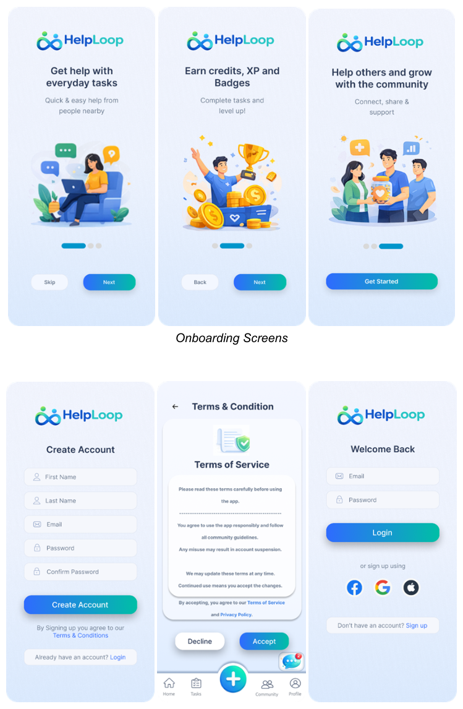
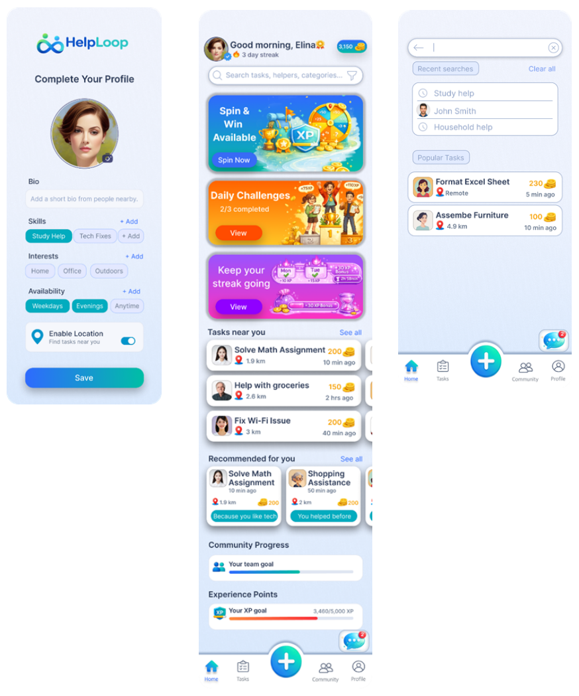
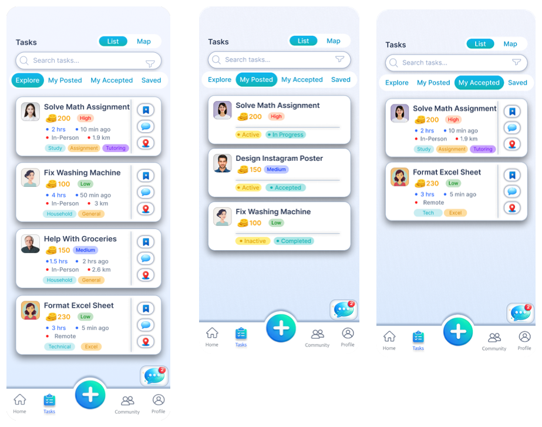
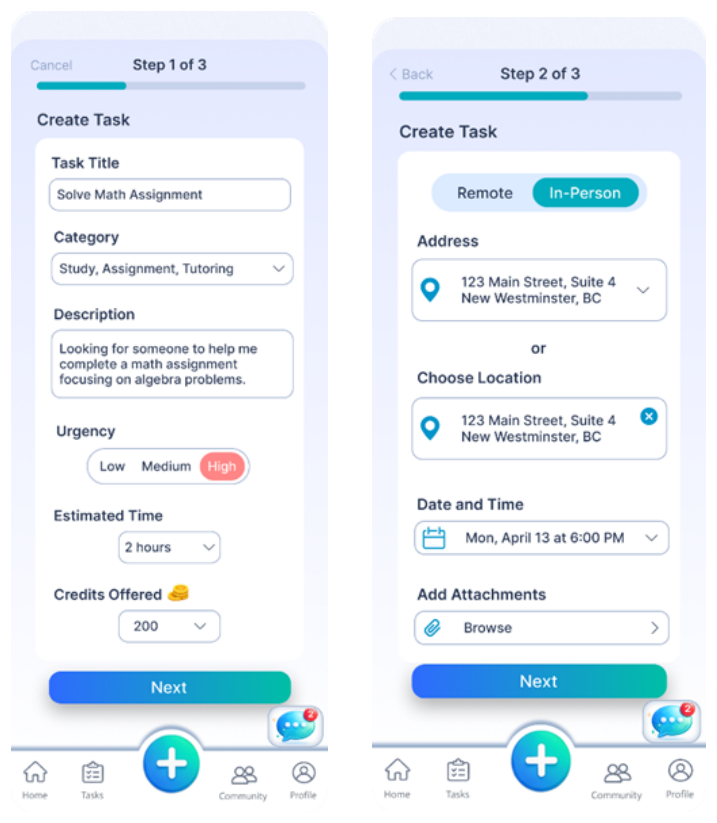
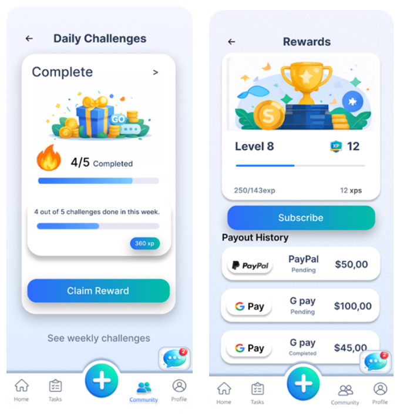
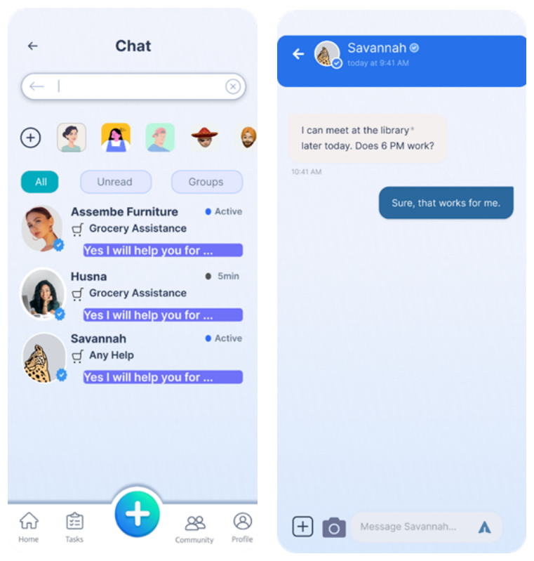

# HelpLoop: Turning Everyday Help into a Rewarding Experience

**HelpLoop** is a gamified mobile app concept that connects people who need quick help with everyday tasks (study help, tech problems, writing, chores) to helpers in their community. Helpers earn **credits, XP, badges and streaks**, take on **daily challenges**, join **teams** and give back through **community donations and fundraising goals**.

This is a UX design project: user research, requirements, personas, wireframes, a high-fidelity interactive **Figma prototype** and a user evaluation, all done in **CSIS 3375 – UX Design in Web & Mobile Apps** at Douglas College (Winter 2026).

▶️ **[Open the interactive Figma prototype](https://www.figma.com/proto/06w9AU54eBE5vHRwVlbI2R/W26_3375_S1_G6_HelpLoop?node-id=1008-4633&starting-point-node-id=1008%3A4633&t=VU93MxkmW5mgelWf-1)**. Click through the screens to explore the flows. If it doesn't start automatically, open the **"Final Flow"** page and press **Present (▶)** in the top-right corner.

---

## Screens

| Onboarding, sign-up & login | Profile, home & search |
|---|---|
|  |  |

| Browse & manage tasks | Post a task |
|---|---|
|  |  |

| Challenges & rewards | In-app chat |
|---|---|
|  |  |

---

## Design process

1. **Research.** Studied inspiration apps (Duolingo, Habitica and others) and ran a Google Forms survey of college students and working professionals about everyday help, trust and motivation.
2. **Requirements.** Built personas and scenarios, then prioritised features with MoSCoW (must / should / could have), such as task posting, in-app chat, ratings and reviews, the credit system and progress tracking.
3. **Design.** Moved from low/mid-fidelity wireframes to a high-fidelity prototype with a shared component library, a consistent blue-teal theme, bottom navigation and a floating "+" action for posting tasks.
4. **Evaluation.** Ran a prototype user study (13 respondents) on navigation, task scenarios, feature usefulness and gamification.
5. **Iteration.** Based on the results, made trust signals (ratings, reviews, verified badges) more visible on task cards, gave the home screen streaks, daily challenges and rewards access, and refined the community and team screens.

**Key findings:** users found the prototype clean and easy to navigate. Higher credits were the strongest reason to accept a task, ratings and reviews were essential for trust, and the task progress tracker was rated very positively.

---

## Documents

All reports are in [`ReportsAndDocuments/`](ReportsAndDocuments):

- [Proposal](ReportsAndDocuments/W26_3375_S1_G6_HelpLoop_Proposal.pdf)
- [Requirements document](ReportsAndDocuments/W26_3375_S1_G6_HelpLoop_RequirementsDocument.pdf): survey, personas, scenarios, feature prioritisation
- [Final report](ReportsAndDocuments/W26_3375_S1_G6_HelpLoop_FinalReport.pdf): full prototype walkthrough, user journey, evaluation and changes
- Progress reports and a Figma tutorial

---

## Team

| Member | Role |
|---|---|
| **Sehjalpreet Kaur** | **Team Lead**: requirements document, personas & survey; designed the onboarding, sign-up/login, profile, home, search, task-browsing, My Tasks and task-posting screens |
| Sungtae Kang | UX research, prototype screens & evaluation |
| Mani Singh | Prototype screens & documentation |

**Tools:** Figma (components, auto layout, interactive prototyping) and Google Forms. Persona images, illustrations and some icons were generated with AI image tools. All design decisions, flows and screens were made by the team (see the AI-use section of the final report).
